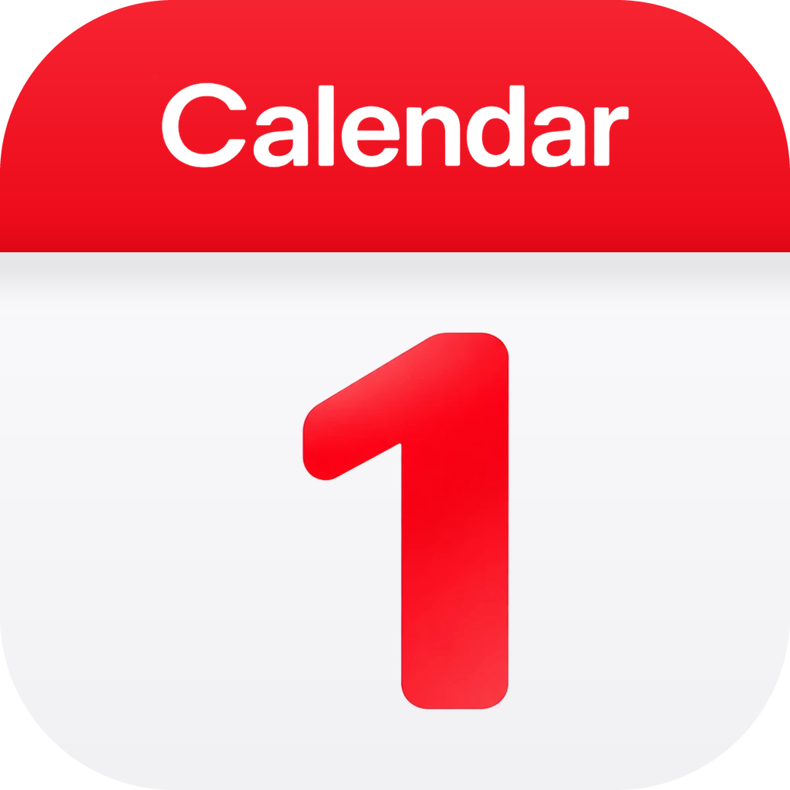
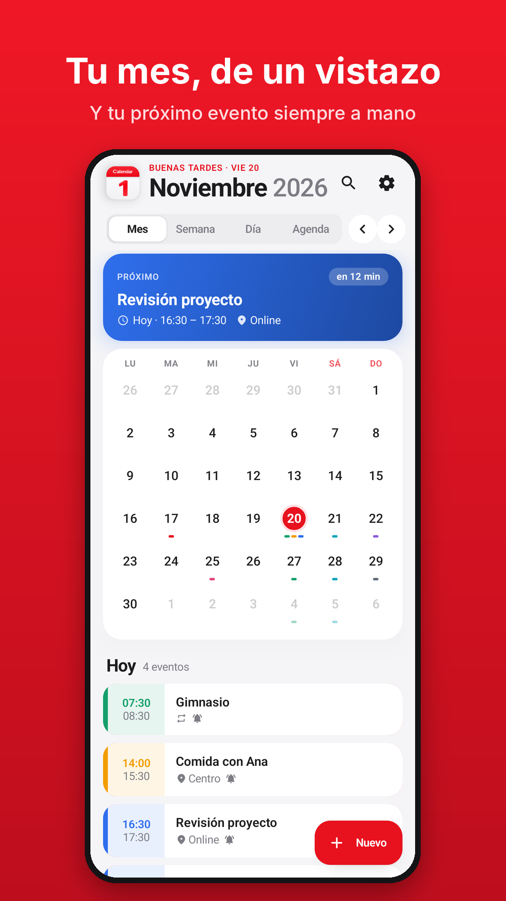
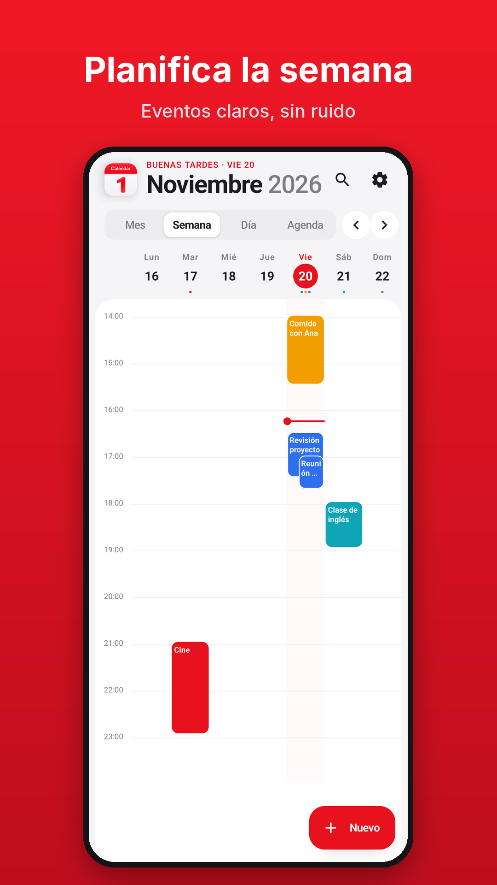
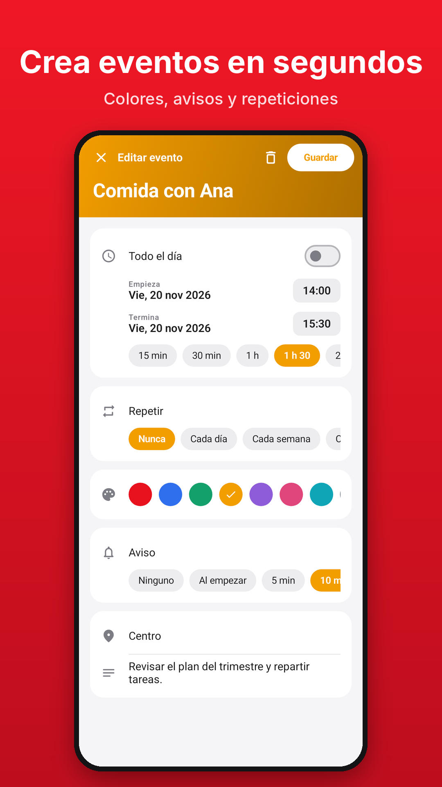

# Calendario



App de calendario para Android: clara, rápida y con todo lo necesario. Está hecha con Kotlin, Jetpack Compose y Room.

**📲 Descargar APK:** [`apk/Calendario-v2.0.apk`](apk/Calendario-v2.0.apk)
**🏪 Publicar en Google Play:** ver [PLAYSTORE.md](PLAYSTORE.md)

| | | |
|---|---|---|
|  |  |  |

## Funciones

- **Vistas**:
  - Mes, Semana, Día y Agenda, con transiciones animadas.
  - Se cambia de periodo deslizando o con las flechas; el botón **Hoy** vuelve al día actual.
- **Próximo evento**: tarjeta con cuenta atrás («en 25 min», «Ahora»).
- **Eventos**:
  - Título, todo el día, inicio y fin con atajos de duración, color, ubicación, notas y aviso.
  - **Repeticiones**: diaria, semanal, mensual o anual, con fecha de fin.
  - **Detalle** en una hoja inferior con Editar, Duplicar y Eliminar.
  - **Deslizar para borrar**, con *Deshacer*.
- **Buscador** por título, lugar o notas (ignora tildes).
- **Avisos**: notificaciones a la hora exacta, que se reprograman al reiniciar el móvil y en cada repetición.
- **Widget «Hoy»** para la pantalla de inicio.
- **Ajustes**: tema (sistema, claro u oscuro), primer día de la semana, formato de 12 o 24 h y aviso por defecto.
- **Pantalla de arranque** con el logo e icono adaptativo, incluido el icono temático de Android 13+.
- **Anuncios no intrusivos**: un banner de AdMob abajo, con consentimiento RGPD (Google UMP).
- Los datos se guardan **solo en el dispositivo**.

## Compilar

```bash
./gradlew assembleDebug      # APK de pruebas (anuncios de prueba)
```

```bash
./gradlew bundleRelease      # AAB para Google Play (ver PLAYSTORE.md)
```

```bash
./gradlew testDebugUnitTest  # tests
```

Los IDs de AdMob se configuran en `gradle.properties`, y la firma de release en `keystore.properties`, que no se sube al repositorio.

## Estructura

```
app/src/main/java/com/ikeralvaro/calendario/
├── data/      Room (Event, repeticiones, migraciones), ajustes (DataStore)
├── notify/    Avisos: AlarmManager + notificaciones
├── ads/       AdMob + consentimiento UMP
├── widget/    Widget «Hoy» (Glance)
└── ui/        Pantallas Compose (mes, semana/día, agenda, editor, búsqueda, ajustes)
playstore/     Icono, gráfico destacado y capturas para la ficha de Play
```
